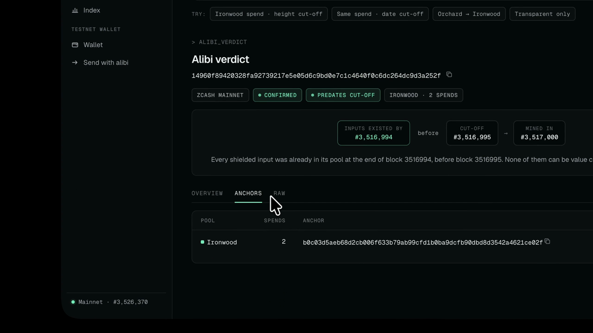
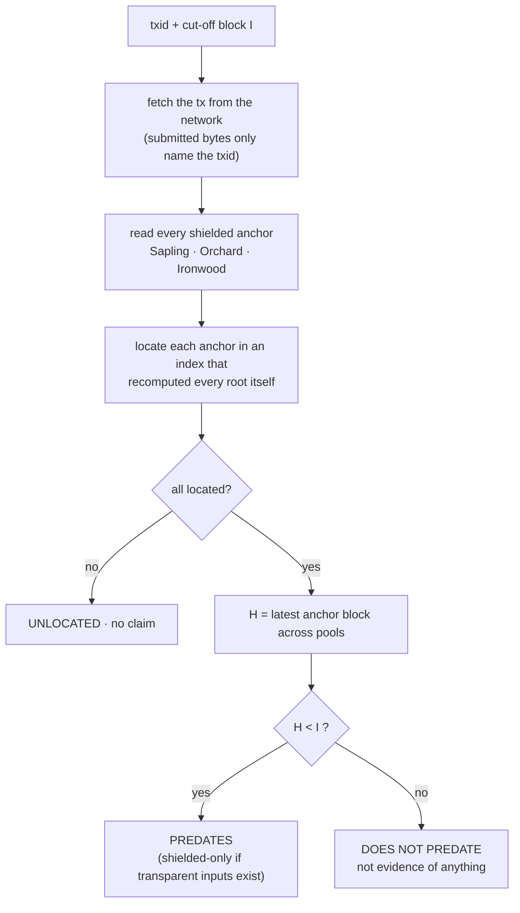
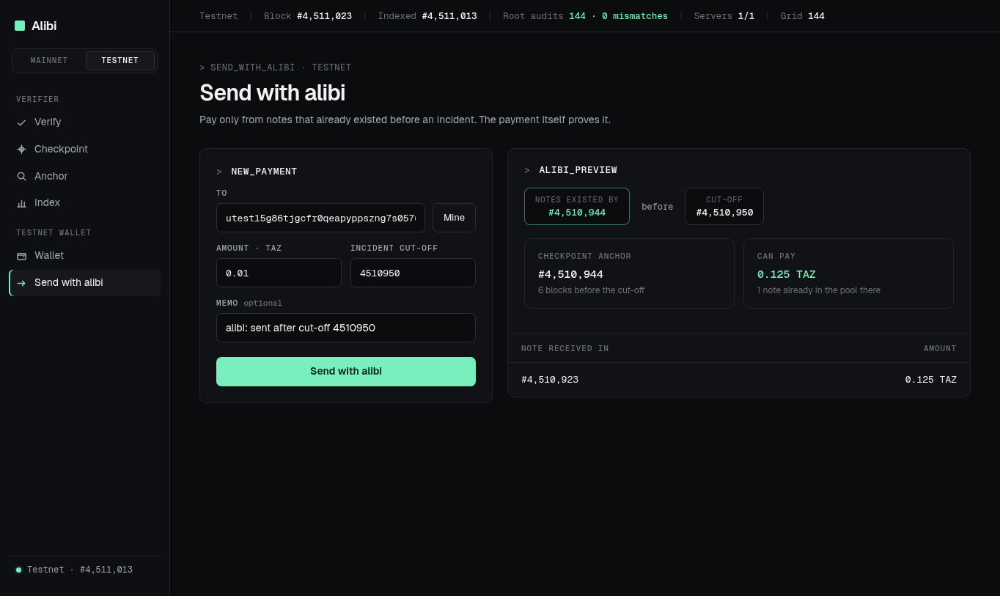
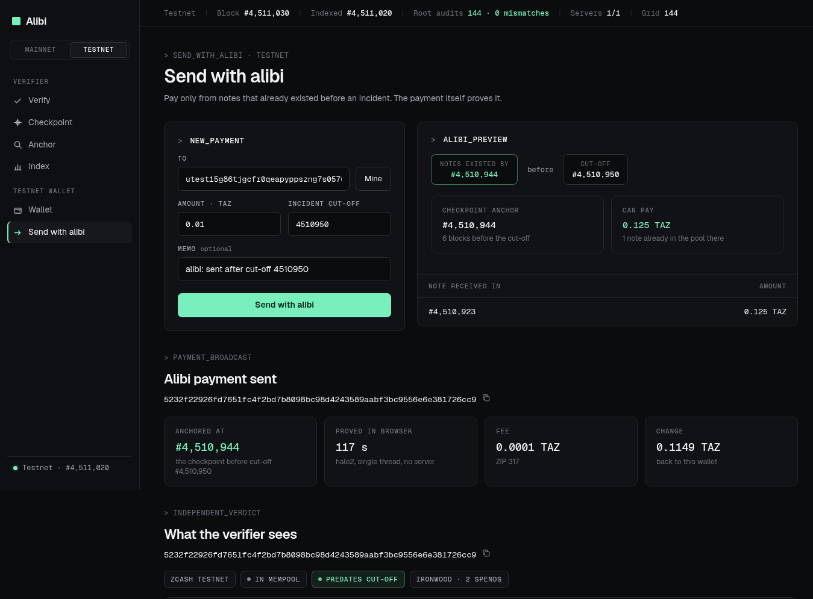
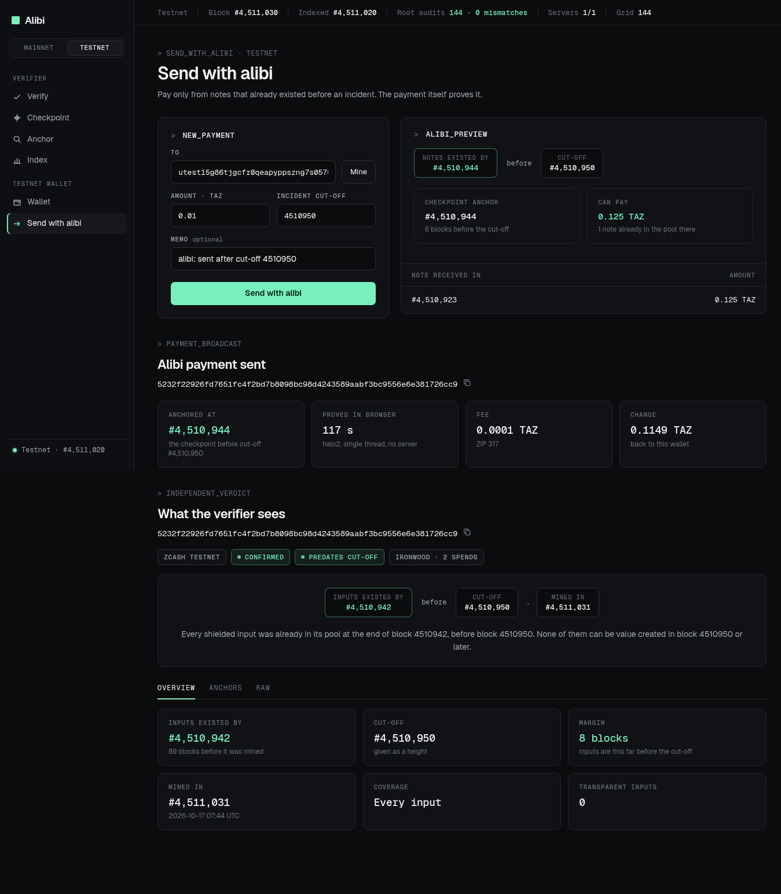

<div align="center">

# ALIBI

### Prove your shielded ZEC predates an incident, from the anchors its spends already commit to.

[](#tests)
[](#verify-every-claim-in-one-command)
[](#live-status)
[](LICENSE)


[](https://youtu.be/lZG8URBbNjg) [](https://alibi-zec.vercel.app/dashboard) [](#whats-real-vs-pending--the-honesty-table) [](#-see-it-in-one-command)

</div>

When stolen funds are moved into a shielded pool, every shielded coin looks the same from outside. An exchange that wants to keep the thief out cannot tell an honest holder from the thief, so honest shielded users get delayed or refused, and today the only way out is to hand over a viewing key and expose a whole history. **Alibi proves that the shielded ZEC a transaction spends was already in the pool before a given block.** The proof reveals one date and nothing else: no balance, no history, no addresses, no viewing key. Nothing new has to be added to the chain to make it work. Every shielded spend already commits to the evidence; Alibi reads it.

```
inputs existed by block H   ∧   H < cut-off I   ⇒   PREDATES
```

There is no "probably". Either every shielded anchor in the transaction is located in an index that recomputed the roots itself, and the latest one sits strictly before the cut-off, or Alibi makes no claim and says why.

## Live status

**Live on mainnet and testnet.** Site, dashboard and API on one origin:
[alibi-zec.vercel.app/dashboard](https://alibi-zec.vercel.app/dashboard) (API under `/v1`). Figures read
from `GET /v1/health` and `scripts/e2e.py` on 2026-10-22, at mainnet block 3,526,397 and testnet block
4,528,225.

| Surface | Status | The evidence |
|---|---|---|
| Mainnet index | **LIVE** | indexed from block 3,428,142 and followed by a cron every 2 minutes; 2,046 root audits against the server's own tree state, **0 mismatches**; 8 of 8 upstream servers reachable |
| Testnet (NU7) index | **LIVE** | indexed from block 4,504,032; 504 root audits, **0 mismatches** |
| Verifier API | **LIVE** | `scripts/e2e.py https://alibi-zec.vercel.app`: **30 calls, 0 failing checks**, transcript in `evidence/` |
| Browser wallet | **LIVE on testnet** | a payment built and proved in the browser (117 s), broadcast and mined; see the next row |
| The whole claim, end to end | **MINED** | tx [`5232f229…6cc9`](https://alibi-zec.vercel.app/dashboard#/verify?tx=5232f22926fd7651fc4f2bd7b8098bc98d4243589aabf3bc9556e6e381726cc9&before=4510950&net=test) mined at block **4,511,031**, after the cut-off **4,510,950**, and the verifier reports every input existed by block **4,510,942**: it predates the cut-off. Screenshots of each step in `evidence/live-send/` |

## ▶ Demo

[](https://youtu.be/lZG8URBbNjg)

**[▶ Watch the demo (4:09)](https://youtu.be/lZG8URBbNjg)** &nbsp;·&nbsp; **[ Live dashboard ↗ ](https://alibi-zec.vercel.app/dashboard)** &nbsp;·&nbsp; **[ What's real vs pending ↗ ](#whats-real-vs-pending--the-honesty-table)** &nbsp;·&nbsp; **[ Run it yourself ↗ ](#-see-it-in-one-command)**

_Published on YouTube. The first 54 seconds are the launch film; the rest is one uncut screen recording of the deployed dashboard against the live mainnet and testnet indexes: no mock state, no staged numbers._ It verifies a mainnet Ironwood spend that predates its cut-off, moves the cut-off back until Alibi makes no claim, checks a two-pool spend and a transparent-only one, finds an incident checkpoint, looks up an anchor, opens the index with its audit count, and ends in the wallet, where a payment against a cut-off older than the wallet's only note is refused rather than anchored somewhere recent.

## The 20-second pitch

A theft lands in the shielded pool at block I. From that moment, every shielded user looks like a possible thief, and the exchanges respond the only way they can: hold the withdrawal, ask for a viewing key, or refuse. The honest user's coins were there for months. Nothing on chain says so in a form anyone can check.

Except it does. Every shielded spend names an anchor, a root of its pool's note-commitment tree at some earlier block, and the zero-knowledge proof shows every spent note is a leaf under that root. A coin created after block H is not in the tree at H. So a transaction anchored before I cannot be spending anything the thief put in at I. Alibi locates the anchor, and a wallet that anchors on purpose turns that into a payment.



## Table of contents

- [Live status](#live-status)
- [▶ Demo](#-demo)
- [The 20-second pitch](#the-20-second-pitch)
- [Table of contents](#table-of-contents)
- [▶ See it in one command](#-see-it-in-one-command)
- [Screenshots](#screenshots)
- [Verify every claim in one command](#verify-every-claim-in-one-command)
- [What Alibi is NOT](#what-alibi-is-not)
- [The problem I set out to solve](#the-problem-i-set-out-to-solve)
- [What I built](#what-i-built)
- [Architecture](#architecture)
- [The verification loop, step by step](#the-verification-loop-step-by-step)
- [Where the guarantee is enforced](#where-the-guarantee-is-enforced)
- [What the index audits measure](#what-the-index-audits-measure)
- [Engineering decisions & the traps that taught me something](#engineering-decisions--the-traps-that-taught-me-something)
- [What's real vs pending — the honesty table](#whats-real-vs-pending--the-honesty-table)
- [Attack → test](#attack--test)
- [The app](#the-app)
- [What it reveals](#what-it-reveals)
- [Limitations](#limitations)
- [Security](#security)
- [Tech stack](#tech-stack)
- [Project layout](#project-layout)
- [Full command reference](#full-command-reference)
- [How it is deployed](#how-it-is-deployed)
- [Results and supporting records](#results-and-supporting-records)
- [Tests](#tests)
- [License](#license)

## ▶ See it in one command

A real mainnet Ironwood spend, mined at block 3,517,000, against a cut-off one block after its anchor:

```console
$ curl -s 'https://alibi-zec.vercel.app/v1/tx/14960f89420328fa92739217e5e05d6c9bd0e7c1c4640f0c6dc264dc9d3a252f?before=3516995' | jq -r '.verdict | .kind, .summary'
predates
Every shielded input was already in its pool at the end of block 3516994, before block 3516995. None of them can be value created in block 3516995 or later.
```

The same transaction, with the cut-off moved to the anchor block itself:

```console
$ curl -s 'https://alibi-zec.vercel.app/v1/tx/14960f89420328fa92739217e5e05d6c9bd0e7c1c4640f0c6dc264dc9d3a252f?before=3516994' | jq -r '.verdict | .kind, .summary'
does_not_predate
The inputs are only shown to exist by the end of block 3516994, which is not before block 3516994. This is not evidence of wrongdoing: the transaction simply makes no claim about block 3516994.
```

The alibi payment made from the browser wallet, mined after the cut-off and still predating it:

```console
$ curl -s 'https://alibi-zec.vercel.app/v1/tx/5232f22926fd7651fc4f2bd7b8098bc98d4243589aabf3bc9556e6e381726cc9?network=test&before=4510950' | jq -r '[.status, .mined.height, .verdict.kind, .verdict.existed_by] | @tsv'
mined	4511031	predates	4510942
```

The anchor on its own, located without any transaction:

```console
$ curl -s https://alibi-zec.vercel.app/v1/anchor/ironwood/b0c03d5aeb68d2cb006f633b79ab99cfd1b0ba9dcfb90dbd8d3542a4621ce02f | jq -c '.location | {height, status}'
{"height":3516994,"status":"located"}
```

Four answers from the live API, not four screenshots. The verifier never needs a key, never sees an address, and refuses to turn "not found" into "older".

## Screenshots

Real captures from the live end-to-end run in `evidence/live-send/`, each captioned from what is on it.

**The preview before paying.** Cut-off #4,510,950, checkpoint anchor #4,510,944 (six blocks before it), one note received at #4,510,923 already in the pool there: can pay 0.125 TAZ.



**Sent.** Anchored at #4,510,944, proved in the browser in 117 s with halo2 on a single thread and no server, fee 0.0001 TAZ (ZIP 317).



**Mined, and still an alibi.** Inputs existed by #4,510,942, before the cut-off #4,510,950, mined in #4,511,031.



## Verify every claim in one command

```console
$ python3 scripts/e2e.py https://alibi-zec.vercel.app
PASS  health reports a mainnet index  (indexed to 3526397, lag 10)
PASS  every root audit so far matched the server's tree state  (2046 audits)
PASS  ironwood spend: anchor root first appeared at block 3,516,994 (tree unchanged to 3,516,996)
PASS  cut-off at the anchor block itself: does not predate
PASS  forged old anchor in raw bytes: refused, never evaluated
PASS  the forged anchor itself is a real old root (so only the proof check stops it)
PASS  alibi payment mined AFTER the cut-off still predates it (inputs existed by 4,510,942)  (mined 4511031)
PASS  relay: bytes that are not a transaction are never broadcast
…
30 calls, 0 failing checks; transcript: evidence/e2e-20261022T065139Z.json
```

Every call and every answer is written to the transcript, so a reader can check the checks. The full list of 31 assertions is in [Results](#results-and-supporting-records).

## What Alibi is NOT

Not a mixer, not a taint score, not a compliance oracle and not a viewing-key service. It does not say a coin is clean. It says one thing, and only when the chain proves it: **the value this transaction spends existed by block H.** The output is a verdict with the blocks behind it, never a probability:

```
PREDATES                                    DOES NOT PREDATE
  inputs existed by   #3,516,994              inputs existed by   #3,516,994
  cut-off             #3,516,995              cut-off             #3,516,994
  ironwood · 2 spends · located               not evidence of wrongdoing: no claim about this block
```

## The problem I set out to solve

An incident is announced at block I. A swap service now has to decide, for every shielded deposit, whether it might be the stolen value. It cannot see inside the pool, so it falls back on blunt instruments: delay everyone, demand viewing keys, or refuse shielded deposits outright. The cost lands on the people the pool exists to protect.

The rule Alibi is built on: **use only what consensus already enforces.** A spend's proof is checked against its anchor by every node, and consensus only accepts roots the chain actually produced. If the anchor's block is before I, no note created at or after I can be among the inputs. That is not a heuristic; it is the same check that makes the spend valid at all.

## What I built

- **A verifier** that takes a txid and a cut-off (a height or a UTC date), fetches the transaction from the network, reads its anchors in every shielded pool and locates each one in its own index.
- **An index** that streams compact blocks from lightwalletd and recomputes the Sapling, Orchard and Ironwood roots itself, block by block, with three independent checks keeping it honest.
- **A wallet** that runs in the browser as an import-free WebAssembly module: it scans with its own viewing key, keeps witnesses at every 144-block checkpoint, and builds a payment anchored at the checkpoint strictly below the cut-off, proved with halo2 in the browser.
- **A dashboard and an API** on one origin, over the same core compiled to WebAssembly, served by Convex and followed by a cron.

## Architecture

```
compact blocks ──► recompute Sapling / Orchard / Ironwood roots locally ──► roots(pool, root → first block)
                         │                                                        │
       leaf count vs block-reported tree size, parent hash, 144-block audits      │
                                                                                  ▼
txid ──► fetch raw tx from lightwalletd ──► parse v4–v6 tx, read anchors ──► locate each anchor ──► verdict
```

| Component | Where | What it does |
|---|---|---|
| Core | `crates/alibi-core` | transaction parsing (v4 to v6), tree roots, the claim rules. No network access |
| Service | `crates/alibi-service` | lightwalletd client, SQLite index, verifier, HTTP API, CLI |
| Core as WebAssembly | `crates/alibi-wasm` | the core as a 866 KB module with no imports, run inside Convex |
| Wallet | `crates/alibi-wallet` | scan, checkpoint witnesses, build and prove a spend (WebAssembly, in a Web Worker) |
| Production backend | `backend/convex` | `chain.ts` talks gRPC to lightwalletd, `ledger.ts` holds the index, `http.ts` serves the API, `crons.ts` follows both chains |
| Dashboard | `app/` | verify, checkpoint, anchor, index and wallet pages (overlaid onto `site/` by the site build) |

**HTTP surface** (every request takes `network=main`, the default, or `network=test`):

| Request | Answer |
|---|---|
| `GET /v1/health` | chain tip, index height, roots per pool, audit count and mismatches |
| `GET /v1/tx/{txid}?network=main&before={height or date}` | verdict for a transaction |
| `POST /v1/verify` `{txid}` or `{hex}` (+ `before`, `network`) | same; raw bytes are only used to compute the txid |
| `GET /v1/anchor/{pool}/{anchor}` | the first block whose root equals this anchor |
| `GET /v1/checkpoint?before=…` | the shared 144-block grid boundary to anchor an alibi spend to, with every pool's root there |
| `GET /v1/cutoff?before=2026-09-24T18:30Z` | the first block at or after a UTC time |
| `GET /v1/chain/tip`, `/v1/chain/treestate?height=`, `/v1/chain/blocks?from=&to=` | relay for the wallet: tip, Ironwood tree state, up to 500 compact blocks |
| `POST /v1/chain/broadcast` `{network, hex}` | relay a finished transaction; bytes that do not parse as a transaction are never sent |

**Verdict kinds:**

| Kind | Meaning |
|---|---|
| `predates` | every input is shielded and existed by a block before the cut-off |
| `predates_shielded_only` | the shielded inputs predate the cut-off; the transparent inputs are not covered |
| `does_not_predate` | the inputs are only shown to exist by a block at or after the cut-off (not evidence of anything) |
| `established` | no cut-off was given; reports the block the inputs existed by |
| `unlocated` | an anchor is not a root the index knows; no claim |
| `no_shielded_inputs` | coinbase or transparent-only; nothing to claim |

## The verification loop, step by step

1. **Resolve the cut-off.** A height is used as given; a UTC date resolves to the first block at or after it (`/v1/cutoff`).
2. **Fetch from the network, not the caller.** The transaction is read from lightwalletd by txid. Submitted raw bytes are used only to compute the txid, and if the network's copy commits to different shielded data, the request is refused with 422.
3. **Read the anchors.** One anchor per shielded pool the transaction spends from: Sapling, Orchard, Ironwood. Orchard-protocol dummy spends are counted, since they carry no value and cannot be told apart from outside.
4. **Locate each anchor** as the first block whose locally recomputed root equals it. Anchors in the last few blocks above the index are found by scanning tree states directly.
5. **Decide.** One unlocated anchor withdraws the whole claim. Otherwise H is the latest anchor block across all pools, and the transaction predates I exactly when H < I. Transparent inputs are reported and never covered.

The wallet runs the same rule in reverse. For a cut-off I it takes the grid checkpoint strictly below I, spends only notes that already had a witness there, proves the spend against that root, broadcasts it, and asks the verifier for the verdict of its own transaction. A note received after the checkpoint has no witness at that root, so a proof for it cannot exist; the wallet refuses rather than fall back to a recent anchor.

## Where the guarantee is enforced

| Guarantee | Module | The test that covers it |
|---|---|---|
| Strictly before the cut-off, never at it | `crates/alibi-core/src/claim.rs` | `strictly_before_the_cutoff_predates`, `anchor_at_the_cutoff_block_does_not_predate` |
| The latest anchor across pools decides | `claim.rs` | `latest_anchor_across_pools_decides` |
| One unlocated anchor withdraws the claim | `claim.rs` | `one_unlocated_anchor_withdraws_the_claim` |
| Transparent inputs are flagged, never covered | `claim.rs` | `transparent_inputs_are_flagged_not_covered` |
| A withheld commitment is caught | `crates/alibi-service/src/index.rs` | `a_block_whose_leaf_count_disagrees_is_rejected` |
| A reorg leaves no orphaned roots | `crates/alibi-service/src/store.rs` | `rewind_forgets_orphaned_roots` |
| The checkpoint is strictly before the cut-off | `crates/alibi-service/src/network.rs` | `boundary_is_strictly_before_the_cutoff` |
| Real mainnet bytes parse, and the anchor is a real root | `crates/alibi-core/tests/real_tx.rs` | `ironwood_anchor_is_the_root_of_the_tree_four_blocks_earlier` |
| The wallet never spends a note newer than its checkpoint | `crates/alibi-wallet/tests/build.rs` | `a_note_newer_than_the_checkpoint_is_never_used` |
| The spend anchors at the checkpoint and its proof verifies | `crates/alibi-wallet/tests/build.rs` | `spend_anchors_at_the_checkpoint_and_the_proof_verifies` |
| Forged bytes are refused, never evaluated | `crates/alibi-service/src/verify.rs` | `scripts/e2e.py`, live: `forged old anchor in raw bytes: refused, never evaluated` |

## What the index audits measure

The index trusts the server only for what it can check, and it checks three things:

1. **Leaf count.** After each block, the number of leaves appended must equal the tree size that block reports. A withheld commitment breaks the count and the batch is rejected.
2. **Parent hash.** Each block must name the previous indexed block as its parent. A mismatch means a reorganization, and the index rewinds 50 blocks and reloads the trees from tree state.
3. **Tree-state audit.** At every 144-block boundary, the local roots are compared with roots derived from the server's own tree state, and every comparison is stored.

On 2026-10-22: **2,046 mainnet audits and 504 testnet audits, 0 mismatches.** `scripts/init-progress.ts` refused to start the Convex index unless the server's tree state at the imported height had exactly the roots the local index computed.

## Engineering decisions & the traps that taught me something

**The txid does not commit to the anchor.** Swapping an old root into a real transaction's bytes keeps the same txid, so a verifier that trusted submitted bytes could be shown any history at all. `POST /v1/verify` therefore uses the bytes only to compute the txid, fetches the network's copy, and refuses the mismatch with 422. The e2e run checks both halves: the forgery is refused, and the forged anchor is a real old root, so only that comparison stops it.

**"Not found" is never "older".** An anchor below the index start could be ancient or could be garbage. Alibi reports it as `unlocated` and makes no claim, instead of inferring age from absence.

**One grid for everyone.** Alibi payments anchor to a shared 144-block grid, not to an arbitrary old block. Everyone proving against the same incident uses the same checkpoint, so the anchor does not single anyone out among them, and grid-aligned old anchors are also what ZIP 318 migration transfers use.

**The wallet ships no Sapling parameters.** It builds transactions with no Sapling bundle, so `crates/alibi-wallet/src/sapling_stub.rs` satisfies the builder's type parameters with provers that are never invoked. The whole wallet is one import-free WebAssembly module, checked by `scripts/build-wallet.sh`.

**The production backend runs the same core.** `alibi-core` compiles to a WebAssembly module with no imports and runs inside Convex, so the deployed verdicts come from the code the tests cover, not a port of it.

## What's real vs pending — the honesty table

| | State | Evidence |
|---|---|---|
| Claim rules (strict cut-off, latest anchor decides, unlocated withdraws, transparent flagged) | **Real — tested** | `claim.rs`, 7 unit tests |
| Transaction parsing on real mainnet bytes | **Real — tested** | `real_tx.rs`, 4 tests on fixtures from mainnet |
| Index: leaf-count check, reorg rewind, first-appearance roots | **Real — tested** | `alibi-service`, 10 unit tests |
| Mainnet index and audits | **Real — live** | 2,046 audits, 0 mismatches, via `/v1/health` |
| Testnet (NU7) index and audits | **Real — live** | 504 audits, 0 mismatches |
| Forged-bytes refusal | **Real — run live** | e2e: refused with 422, and the forged anchor is a real old root |
| Wallet: checkpoint-anchored spend whose halo2 proof verifies | **Real — tested** | `crates/alibi-wallet/tests/build.rs`, 5 tests |
| Alibi payment from the live dashboard | **Real — mined on testnet** | tx `5232f229…6cc9`, mined 4,511,031, inputs existed by 4,510,942, cut-off 4,510,950; `evidence/live-send/` |
| Live API end to end | **Real — run** | 30 calls, 0 failing, `evidence/e2e-20261022T065139Z.json` |
| Wallet on mainnet | **Pending** | the wallet is testnet-only; its seed is kept unencrypted in `localStorage` |
| Testnet fallback server | **Pending** | testnet has one public lightwalletd that answers (`testnet.zec.rocks`), so the testnet index and the relay have no fallback |

## Attack → test

| Attack | Answer | Where |
|---|---|---|
| Put an old root in a transaction's bytes and show it to a checker | bytes only name the txid; the network's copy is compared and a mismatch is refused (422) | `verify.rs`; e2e `forged old anchor in raw bytes` |
| Serve a compact block with a commitment withheld | the leaf count no longer matches the block's reported tree size, so the batch is rejected | `index.rs`; `a_block_whose_leaf_count_disagrees_is_rejected` |
| Serve compact blocks that disagree with the server's own tree state | the 144-block audit fails and the index rewinds instead of building on the mismatch | `index.rs`, `store.rs`; `audits_count_mismatches` |
| Reorganize the chain under the index | a parent-hash mismatch rewinds 50 blocks and reloads the trees from tree state | `index.rs`; `rewind_forgets_orphaned_roots` |
| Claim an anchor older than the index | reported as `unlocated`; Alibi never infers "older" from "not found" | `claim.rs`; e2e `random 32 bytes as an anchor: not located` |
| Spend an old note and a new note together | one anchor per pool, and the latest anchor across pools decides | `claim.rs`; `latest_anchor_across_pools_decides` |
| Fund an alibi payment with a note received after the incident | it has no witness at the checkpoint root; the wallet refuses rather than re-anchor | `build.rs`; `a_note_newer_than_the_checkpoint_is_never_used` |
| Use the relay to broadcast junk | bytes that do not parse as a transaction are never sent | e2e `relay: bytes that are not a transaction are never broadcast` |

## The app

[alibi-zec.vercel.app/dashboard](https://alibi-zec.vercel.app/dashboard), with a mainnet/testnet switch:

- **Verify.** Paste a txid and a cut-off (height or date). The verdict shows the block the inputs existed by, the cut-off, the pools and spend counts, each anchor with its block, and the raw transaction.
- **Checkpoint.** The shared anchor for an incident: the last grid block before the cut-off, with every pool's root there.
- **Anchor.** The first block whose pool root equals a given anchor.
- **Index.** Tip, indexed height, roots per pool, audit count and mismatches.
- **Wallet** and **Send with alibi.** A testnet wallet that scans, keeps checkpoints, previews what it can pay for a cut-off, proves in the browser and broadcasts.

## What it reveals

- **The claim itself.** An alibi payment says "my inputs were in the pool by checkpoint C". The inputs hide among every note in the Ironwood tree at C, not among the notes of one user.
- **That the payment carries an old anchor.** An anchor more than a few blocks old marks the payment as deliberate.
- **To the relay.** The block ranges a wallet syncs (which implies roughly when it was created), its IP address, and the raw transaction it broadcasts, the same as any lightwalletd sees. It never sees a key, an address or a note. Run your own lightwalletd to remove that.
- **In the browser.** The seed and wallet state are kept in `localStorage`, unencrypted. This is a testnet wallet.

## Limitations

- Anchors older than the index start (block 3,428,142 on mainnet) are not evaluated.
- Transparent inputs are reported but never covered.
- Orchard-protocol bundles pad with dummy spends. These are zero-value and counted as spends, because they cannot be told apart from outside. The claim concerns value, and dummies carry none.
- The index trusts the server only for what it can check: leaf counts, parent hashes and the periodic tree-state audit. Running against your own lightwalletd or Zaino removes that trust.
- Testnet runs NU7 (branch `77190ad9`). The workspace builds on the pre-release zcash crates that support it (`zcash_primitives 0.31.0-pre.2`, `zcash_protocol 0.11.0-pre.1`).
- The wallet spends Ironwood notes only. Proving runs single-threaded in WebAssembly: about two minutes on a 2-core 2017 laptop, 28 s natively on the same machine.
- The wallet keeps witnesses for the last 60 checkpoints (about 7.5 days on testnet); a cut-off older than that needs a restore from the seed with an earlier birthday.

## Security

The verifier holds no keys and needs none. Its only inputs are a txid, a cut-off and the chain, and everything it reports is recomputed from blocks it checked. The wallet's keys are derived in the browser (ZIP 32, account 0) from a seed generated there, and scanning and proving happen in a Web Worker; the relay receives block-range requests and finished transactions only. The wallet is testnet-only because its state is not encrypted at rest.

## Tech stack

| | |
|---|---|
| Language | Rust (workspace of four crates) |
| Zcash | `zcash_primitives`, `zcash_protocol`, `orchard` (halo2), `sapling-crypto`, `incrementalmerkletree` |
| Chain access | lightwalletd gRPC (`proto/`) |
| Index store | SQLite (self-hosted) · Convex tables (production) |
| Production backend | Convex: Node actions, HTTP routes, crons, the core as WebAssembly |
| Wallet | import-free WebAssembly in a Web Worker |
| Frontend | static HTML, CSS and JavaScript on Vercel |
| Tests | `cargo test`, plus `scripts/e2e.py` against a live deployment |

## Project layout

```
alibi/
├── crates/alibi-core      tx parsing, tree roots, claim rules (no network)
├── crates/alibi-service   lightwalletd client, SQLite index, verifier, HTTP API, CLI
├── crates/alibi-wasm      the core as an import-free WebAssembly module
├── crates/alibi-wallet    the alibi wallet: scan, checkpoint witnesses, build and prove (wasm)
├── app/                   dashboard and wallet UI (overlaid onto site/ by the site build)
├── backend/               Convex deployment: index, cron, HTTP API
├── proto/                 lightwalletd protocol
├── scripts/               e2e.py · live-send.py · wallet.mjs · build-wallet.sh
├── evidence/              e2e transcripts and the live-send screenshots
├── docs/media/            the demo poster
├── deploy/                systemd unit and installer
├── site/                  the deployed site: landing page, /dashboard, the wallet module
└── LICENSE                MIT
```

## Full command reference

```console
cargo test --release                      # core + service + wallet tests (real mainnet fixtures included)
./target/release/alibi check-root --pool ironwood --height 3516996 \
    --anchor b0c03d5aeb68d2cb006f633b79ab99cfd1b0ba9dcfb90dbd8d3542a4621ce02f
python3 scripts/e2e.py http://127.0.0.1:8790   # live checks, transcript written to evidence/
sh scripts/build-wallet.sh                # the browser wallet module, checked to have no imports
node scripts/wallet.mjs new|sync|status|send|verify   # the same wallet engine from the command line
```

`check-root` recomputes a root straight from the server's tree state, with no index involved.

Run the service yourself:

```console
cargo build --release
./target/release/alibi --db data/alibi.db index      # build the index (about an hour for mainnet)
./target/release/alibi --db data/alibi.db serve --bind 127.0.0.1:8790
```

Environment: `ALIBI_DB`, `ALIBI_BIND`, `ALIBI_NETWORKS` (`main`, `test`), `ALIBI_LWD_MAIN`, `ALIBI_LWD_TEST`, `RUST_LOG`. The default upstream is a public lightwalletd. Point it at your own for zero trust. Building needs `protoc` on the path.

## How it is deployed

**Convex (production).** `backend/` holds a Convex app:

- `alibi-core` compiles to a 866 KB WebAssembly module with no imports (`crates/alibi-wasm`); `npm run wasm` embeds it into `convex/lib/wasmBytes.ts`;
- Node actions (`convex/chain.ts`) talk gRPC to lightwalletd and run the core in WebAssembly;
- `convex/ledger.ts` holds the index (blocks, roots, audits, progress), `convex/http.ts` serves the same API as the Rust server, and `convex/crons.ts` follows both chains every two minutes;
- the historical index was imported from the Rust indexer's SQLite file (`npx convex import`), and `scripts/init-progress.ts` refuses to start the Convex index unless the server's tree state at the imported height has exactly the roots the local index computed.

```console
cargo build --release -p alibi-wasm --target wasm32-unknown-unknown
cd backend && npm install && npm run wasm && npx convex deploy
```

**Self-hosted.** `deploy/install.sh` installs the binary, an optional pre-built index and a systemd unit under `/opt/alibi`, `/etc/alibi` and `alibi.service`. It touches nothing else. The binary needs glibc 2.34 or newer.

## Results and supporting records

Each row is an artifact a reader can open. Where prose and artifact disagree, **the artifact is the authority**.

| Evidence | What it supports |
|---|---|
| **[▶ The demo](https://youtu.be/lZG8URBbNjg)** (4:09, on YouTube) | the dashboard against the live indexes, uncut |
| `evidence/live-send/` | the alibi payment, step by step: wallet, preview, sent, verdict, mined, plus `run.log` |
| `evidence/e2e-*.json` | every e2e run against the live API, each call and answer recorded |
| `GET /v1/health` | index heights, roots per pool, audit counts, mismatches, upstream reachability |
| `crates/*/tests/`, `#[cfg(test)]` modules | the 28 tests below |
| `crates/alibi-core/tests/fixtures/` | the mainnet transaction and Ironwood tree the parsing tests run on |

The full e2e assertion list, from the 2026-10-22 run:

```
PASS  health reports a mainnet index  (indexed to 3526397, lag 10)
PASS  every root audit so far matched the server's tree state  (2046 audits)
PASS  ironwood spend: anchor root first appeared at block 3,516,994 (tree unchanged to 3,516,996)
PASS  cut-off one block later: predates (transparent output only, no transparent inputs)
PASS  cut-off at the anchor block itself: does not predate
PASS  date cut-off resolves to a block and the recent anchor does not predate it  (2026-09-24 -> block 3493964)
PASS  sapling spend: sapling anchor located  (anchor 5 blocks before mining)
PASS  orchard spend: orchard anchor located  (anchor 15 blocks before mining)
PASS  Orchard -> Ironwood crossing: anchor located
PASS  shielded coinbase: no shielded inputs, no claim
PASS  transparent-only transaction: no claim
PASS  unknown txid: 404
PASS  malformed txid: 400
PASS  unparseable cut-off: 400
PASS  raw bytes of a mined transaction: evaluated from the network's copy
PASS  checkpoint for 2026-09-24: a grid block strictly before the cut-off, with every pool's root  (anchor block 3493872 for cut-off 3493964)
PASS  forged old anchor in raw bytes: refused, never evaluated
PASS  the forged anchor itself is a real old root (so only the proof check stops it)
PASS  random 32 bytes as an anchor: not located
PASS  health reports a testnet index with no audit mismatches  (indexed to 4528225, 504 audits)
PASS  testnet NU7 transaction parses: Ironwood spend with one anchor
PASS  alibi payment mined AFTER the cut-off still predates it (inputs existed by 4,510,942)  (mined 4511031)
PASS  the same payment makes no claim for a cut-off at its anchor block
PASS  relay: testnet tip  (4528240)
PASS  relay: tree state returns the Ironwood tree and its root
PASS  relay: ten compact blocks, framed
PASS  relay: more than 500 blocks in one request is refused  (at most 500 blocks per request)
PASS  relay: reversed range is refused
PASS  relay: bytes that are not a transaction are never broadcast
PASS  relay: non-hex body refused
PASS  relay: unknown network refused
30 calls, 0 failing checks; transcript: evidence/e2e-20261022T065139Z.json
```

## Tests

```console
$ cargo test --release
test result: ok. 9 passed; 0 failed     # alibi-core unit tests
test result: ok. 4 passed; 0 failed     # alibi-core tests/real_tx.rs
test result: ok. 10 passed; 0 failed    # alibi-service
test result: ok. 5 passed; 0 failed     # alibi-wallet tests/build.rs (builds and proves a spend)
```

**28 tests.** By crate:

```
alibi-core (claim, tree)          9   strictly_before_the_cutoff_predates · anchor_at_the_cutoff_block_does_not_predate
                                      latest_anchor_across_pools_decides · one_unlocated_anchor_withdraws_the_claim
                                      transparent_inputs_are_flagged_not_covered · outputs_only_make_no_claim
                                      no_cutoff_only_establishes · invalid_leaf_is_refused
                                      empty_tree_state_matches_empty_frontier
alibi-core tests/real_tx.rs       4   parses_a_mainnet_v6_ironwood_transaction · truncated_bytes_are_refused
                                      trailing_bytes_are_refused · ironwood_anchor_is_the_root_of_the_tree_four_blocks_earlier
alibi-service                    10   boundary_is_strictly_before_the_cutoff · txid_validation · utc_parsing
                                      display_hash_reverses_wire_order · a_malformed_commitment_is_rejected
                                      a_block_whose_leaf_count_disagrees_is_rejected · audits_count_mismatches
                                      first_appearance_wins_and_root_at_follows_the_chain · rewind_forgets_orphaned_roots
                                      records_a_root_only_for_pools_that_changed
alibi-wallet tests/build.rs       5   addresses_round_trip_and_reject_the_wrong_network · a_note_being_spent_is_not_offered_again
                                      a_note_newer_than_the_checkpoint_is_never_used · an_anchor_the_wallet_did_not_checkpoint_is_refused
                                      spend_anchors_at_the_checkpoint_and_the_proof_verifies
                                ---
                                 28
```

One caveat on everything above: nothing in this file is aspirational. If a line here is not backed by an artifact you can run, it is a bug in the file.

## License

MIT. See [LICENSE](LICENSE).
